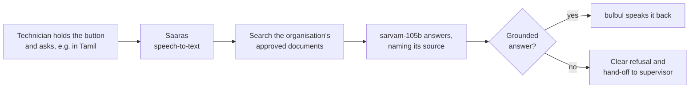
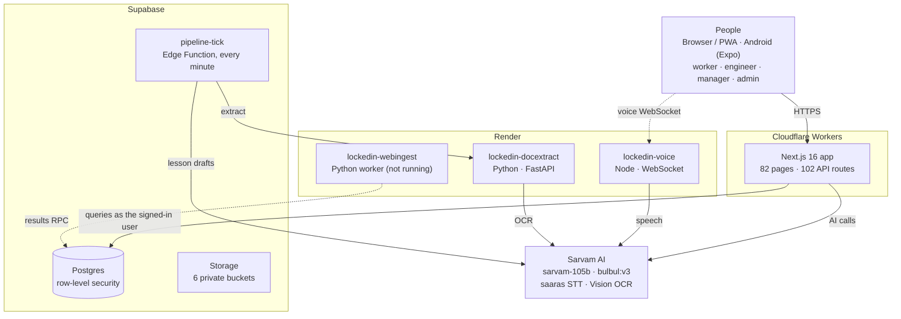
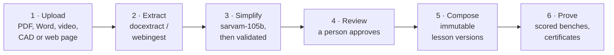
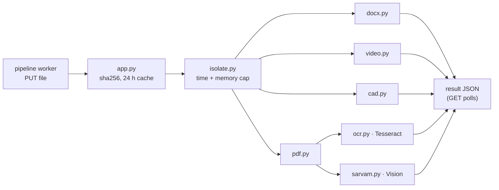

# Blue: voice-first training for India's shop floors

**CSI3007 Advanced Python Programming · Course project and portfolio**

Monish Jagatheswaran · 23MIC0098 · Slot C1 (theory), L31+L32+L49+L50 (lab) · Faculty: Dr. Sharmila Banu K

| | |
|---|---|
| **Course portfolio (all assessments)** | https://monish-csi3007-portfolio.vercel.app |
| **Project pitch video (2 min 42 s)** | [Google Drive](https://drive.google.com/file/d/1vEcCLuXax6FLmlYWpzzKcltcZt0ypgsv/view?usp=sharing) |
| **Concept design, Lab Assessment 3** | [Figma: Production Estimator](https://www.figma.com/design/I1qUH2tq89MEr2NVjYf9Ie/Production-Estimator?node-id=0-1&t=V3G35Pd5uCzOK4i7-1) |
| **Project status** | Live: `staging/blue` released to production on 15 October 2026 |

> Blue is presented in the product deck under the name **Insyde**: *machine training from the inside*.

---

## Contents

1. [What Blue does](#1-what-blue-does)
2. [The problem](#2-the-problem)
3. [Who it is for](#3-who-it-is-for)
4. [Features](#4-features)
5. [HYDRO, the voice tutor](#5-hydro-the-voice-tutor)
6. [Architecture](#6-architecture)
7. [How the main requests flow](#7-how-the-main-requests-flow)
8. [Manual in, lesson out](#8-manual-in-lesson-out)
9. [The Python services](#9-the-python-services)
10. [Frontend](#10-frontend)
11. [Hosting and environments](#11-hosting-and-environments)
12. [Data, security and storage](#12-data-security-and-storage)
13. [Roadmap](#13-roadmap)
14. [Pitch video storyboard](#14-pitch-video-storyboard)
15. [Changes since the first project report](#15-changes-since-the-first-project-report)
16. [The rest of the course portfolio](#16-the-rest-of-the-course-portfolio)
17. [This repository](#17-this-repository)

---

## 1. What Blue does

Blue is a multilingual training platform for industrial maintenance teams. It turns an employer's own manuals and standard operating procedures into lessons, 3D machine models and **HYDRO**, an AI voice tutor.

A technician holds one button and asks a question in their own language. HYDRO answers out loud from the company's approved documents and names the document it used. If the documents don't cover the question, it says so and hands off to a supervisor. Managers approve every AI-drafted lesson before anyone is assigned it, and they can see where the skill gaps are.

## 2. The problem

| | |
|---|---|
| **21 million** | people work in India's registered factories (Annual Survey of Industries 2024–25) |
| **4.2%** | of people aged 15–59 have had formal vocational training (Periodic Labour Force Survey 2025) |

- **Manuals nobody reads.** Knowledge sits in English PDFs, CAD files and senior people's heads.
- **No one to ask at 2 a.m.** A night-shift operator facing an alarm has no expert beside the machine.
- **Completion is not competence.** Clicking through slides counts as training; real skill is never proven.

What exists today doesn't close the gap. Course sites teach desk skills in English. Corporate learning systems record who clicked through a module, not who can do the job. Specialist hydraulics courses are English-only and generic. General chatbots answer from the internet, not from the plant's own procedures.

## 3. Who it is for

| Role | Job | What Blue gives them |
|---|---|---|
| **Worker** | Learns the job on the machine | Step-by-step lessons on the 3D twin; asks HYDRO by voice in their language; web or Android app |
| **Engineer** | Goes deep on the system | Hydraulics and CNC industry packs; scored simulators and test benches; twin tools (explode, section, hotspots) |
| **Manager** | Builds and signs off the training | Turns manuals and CAD into lessons; reviews every AI draft before release; skill matrix and completion certificates |
| **Admin** | Runs the organisation | Departments, users and invites, documents, sources and review, settings |

## 4. Features

| Feature | Status | What it does |
|---|---|---|
| HYDRO voice tutor | Live | Voice questions answered from approved documents, streamed back as speech. Capped at 200 questions per person per day. |
| Ask a doubt | Live | Select the part in a photo or video; HYDRO answers on the image, or a supervisor replies. |
| Source to lesson | Live | PDF, Word, video and CAD files become reviewed, versioned lessons. |
| 3D machine models | Live | `model-viewer` and three.js simulations, loaded only when needed. The hydraulics pack has 15 courses and 25 simulators. |
| Certificate check | Live | Public `/verify/certificate/[id]` lookup. A record of completion, not an accredited qualification. |
| Android app | Prototype | Expo and React Native worker and engineer screens on the same API. Release is on the backlog. |
| Web ingestion | Prototype | Python worker that turns approved web pages into sources. Declared in `render.yaml`, not running. |
| CAD converter | Prototype | Converts very large STEP files to 3D models on AWS ECS Fargate. Described in the product deck. |

## 5. HYDRO, the voice tutor

HYDRO is the project's unique element.

- **Full duplex with barge-in.** It listens while it speaks, so the worker can interrupt.
- **Hands-free or push-to-talk.** Gloves on, hands busy: the operator just talks.
- **Knows the screen.** It answers about the part or step that is open in front of the worker.
- **Fast.** Speech is streamed, so the first word arrives in about a second.
- **Languages.** HYDRO and voice cover 26 Indian languages and dialects through Sarvam AI. The interface itself is in English, Hindi and Marathi.

Example from the pitch video, asked and answered in Tamil:

> *"The relief valve is there, so why does the pressure keep dropping?"*
> *"If there's a leak inside the pump, the pressure will drop. The relief valve only controls high pressure."*

## 6. Architecture

One web app on Cloudflare, Supabase for data, Sarvam for every AI call, and small services on Render.

| Part | Role |
|---|---|
| **Cloudflare Worker `blue`** | The Next.js app. Serves every page and every API call; auth is checked on every call. Built with OpenNext; a staging copy runs as `blue-staging`. |
| **Supabase** | Postgres with row-level security per organisation, Auth (email, phone, Google, invites), 6 private storage buckets, and the `pipeline-tick` Edge Function that runs the lesson pipeline every minute. |
| **Sarvam AI** | The only AI provider: `sarvam-105b` chat (HYDRO, doubts, lesson writing), `bulbul:v3` text-to-speech, `saaras` / `saarika` speech-to-text, Vision OCR and `mayura` translation. |
| **Render** | `lockedin-voice` (WebSocket voice tutor), `lockedin-docextract` (Python document extraction) and `lockedin-webingest` (declared, not running). |

## 7. How the main requests flow

| Request | Path through the system |
|---|---|
| **Opening a page** | The Worker renders the page; the signed-in session lives in a cookie (`@supabase/ssr`). The route group checks the role before anything is shown. |
| **Asking HYDRO** | The browser sends the question with the page's text → `/api/engineer/tutor` checks the session and the daily limit → searches the organisation's approved documents in Postgres → Sarvam answers, streamed back. |
| **Ask a doubt** | Photos and videos upload straight to the `doubt-media` bucket with one-time links → `/api/doubts` stores the doubt → HYDRO answers on the photo, or a supervisor replies. |
| **Document → lesson** | An admin uploads a source to `lesson-sources` → `pipeline-tick` sends it to docextract → Sarvam drafts the lesson → it waits in the review queue → published and assigned. |
| **Voice** | The device opens a WebSocket to `lockedin-voice`, which streams speech-to-text, the reply and text-to-speech through Sarvam. |
| **Certificate check** | `/verify/certificate/[id]` looks the record up in `course_certificates`. |

## 8. Manual in, lesson out

No AI draft reaches a worker until a person approves it, and safety items need an admin. A client's sources never leave their organisation: the API runs as the caller, so row-level security is the gate.

## 9. The Python services

Most of the backend is TypeScript: the 102 API routes, the voice service and the lesson pipeline. Python is used where its libraries are the right tool: reading PDFs, Word and CAD files, OCR, video transcripts, and fetching approved web pages safely. Both services need Python 3.12 and run in Docker on Render, with 15 source files between them.

### docextract: documents, CAD and video to text
FastAPI web service · `services/docextract/docextract/`

| File | Lines | Role | What it does |
|---|---:|---|---|
| `app.py` | 347 | The Front Desk | HTTP front for the extractors. Takes a file by sha256, caches results for 24 h, answers polls. Health check at `/healthz`. |
| `isolate.py` | 165 | The Safe Room | Runs each extraction in a child process with a time and memory limit, so one bad file cannot take the service down. |
| `pdf.py` | 338 | The Reader | PDF to page-scoped text blocks and embedded images with PyMuPDF, with OCR for scanned pages. |
| `ocr.py` | 86 | The Eyes | Tesseract OCR grouped into paragraphs, each with a confidence. |
| `sarvam.py` | 450 | The Interpreter | Sarvam Vision document-intelligence client with typed errors for auth, rate limits and timeouts. |
| `docx.py` | 466 | The Wordsmith | Word files to headings, paragraphs and tables. Standard library only. |
| `video.py` | 363 | The Listener | Video or audio to a timed transcript with ffmpeg and Sarvam speech-to-text. |
| `cad.py` | 800 | The Draughtsman | CAD files to the text they carry (titles, part lists, notes), never their geometry. |
| `errors.py` | 34 | The Rulebook | One `ExtractError` with codes, so the pipeline can tell "retry" from "this file cannot be read". |
| `__init__.py` | 0 | Package marker | |

Needs `fastapi`, `uvicorn`, `pymupdf`, `pytesseract`, `pillow`, plus `tesseract-ocr` with 11 language packs and `ffmpeg`.

### webingest: approved web pages to source documents
Background worker · `services/webingest/webingest/` · **Prototype** (declared, not running)

| File | Lines | Role | What it does |
|---|---:|---|---|
| `worker.py` | 273 | The Dispatcher | Claims queued fetch requests from Postgres, rate-limits each host, retries up to 2 times, hands results back by RPC. |
| `netguard.py` | 392 | The Bodyguard | SSRF-safe fetching: its own DNS lookup, blocked private IP ranges, IP pinning, manual redirects, size and time caps. |
| `policy.py` | 261 | The Gatekeeper | URL canonicalisation, per-organisation allow rules and robots.txt. |
| `extract.py` | 273 | The Editor | HTML to title, canonical link and clean text with Scrapling's parser; drops hidden text and flags prompt injection. |
| `__init__.py` | 3 | The Name Tag | Package description and version. |

Needs `scrapling` 0.4.15 (parser only) and `httpx` 0.28.1. Every result is saved with full provenance (URL, robots result, parser version, licence basis), or with a "denied" or "failed" reason.

### cad-converter (from the product deck)
**Prototype.** `handler.py` (The Heavy Lifter) uses OpenCascade to read, mesh and cap the triangles of STEP files too big for the ~2 GB WebAssembly limit. It runs on AWS ECS Fargate, reading from and writing to S3, and returns `{ ok, triangles, seconds, maxRssMb }`. It was built for a 260 MB Inventor export of a CNC mill.

### Running and testing locally
From each service folder: `uv sync && uv run docextract` (or `uv run webingest`). Tests run with `uv run pytest`: 10 test files for docextract and 7 for webingest. Production images are built from `services/<name>/Dockerfile`.

## 10. Frontend

One Next.js app with four role portals, built for low-end Android phones on weak networks. Worker screens read like a consumer app (one main action, big tap targets); manager and admin screens are denser. It installs as a PWA, and an Expo Android app shares the same backend.

| Layer | Choice |
|---|---|
| Framework | Next.js 16.3 (App Router), React 19.2, TypeScript |
| Styling | Tailwind CSS 4, shadcn/ui (Base UI), one white / ink / blue design system |
| Data and sign-in | Supabase JS 2 with `@supabase/ssr`; Zod 4 validates every request |
| 3D and maths | `@google/model-viewer` 4, three.js 0.183 (loaded only when needed), KaTeX |
| Motion, icons, fonts | Framer Motion, Lucide icons, self-hosted Geist Sans and Mono, Inter and two serif display faces |
| Mobile | Expo 57, React Native 0.86, Expo Router |
| Deploy | OpenNext and Wrangler to Cloudflare Workers |

| Portal | Who | Pages | Main screens |
|---|---|---:|---|
| `(worker)` | Workers (managers and admins can look in) | 23 | Home, assigned lessons, my learning, library, lessons, assessments, Ask a doubt, progress, profile |
| `(engineer)` | Engineers, managers, admins | 21 | Curriculum and labs, catalogue, 3D models, HYDRO tutor, Ask a doubt, progress |
| `(manager)` | Managers, admins | 13 | Team dashboard, workers and invites, learning paths, review, doubt inbox, knowledge base, skills |
| `(admin)` | Admins | 13 | Overview, departments, users and invites, documents, sources and review, lessons, industry setup, settings |
| `(auth)`, lander, verify | Anyone | 5 | Sign-in, invite, public landing page, certificate check |

There is no public sign-up: people join through an employer's invite.

## 11. Hosting and environments

| Part | Where | Details |
|---|---|---|
| Web app and API | Cloudflare Workers | Worker `blue` (production) and `blue-staging`, built with OpenNext and deployed from GitHub. Static assets, including the bundled 3D models, are served from Cloudflare. |
| Database, sign-in, files | Supabase (managed Postgres) | Row-level security, Auth, 6 private storage buckets, the `pipeline-tick` Edge Function on `pg_cron`. Migrations apply automatically when `master` changes. |
| Voice service | Render (Oregon) | `lockedin-voice`, Node, from `services/voice/Dockerfile` |
| Document extraction | Render (Oregon) | `lockedin-docextract`, Python, from `services/docextract/Dockerfile`; deploys only after CI passes |
| Web ingestion | Render (declared) | `lockedin-webingest` background worker; in `render.yaml`, not running |
| AI | Sarvam AI (India) | Chat, speech-to-text, text-to-speech, vision OCR and translation. Keys stay on the servers. |
| CI | GitHub Actions | Types, lint and tests for the web app; database tests; each service's tests; deploy-config and content-provenance checks on every pull request |

## 12. Data, security and storage

- **Row-level security.** Every table is scoped to an organisation in Postgres itself, with four roles: worker, engineer, manager, admin.
- **Server-verified completion.** Course completion is checked on the server, never trusted from the browser.
- **Usage limits.** AI use is capped per person per day in Postgres (HYDRO: 200 questions).
- **SSRF-safe web fetching.** `netguard.py` vets and pins every IP; private networks are unreachable.
- **Isolated extraction.** A hostile PDF runs in a child process with time and memory limits.
- **Humans approve AI.** No AI draft reaches a worker until a person reviews it.
- **Immutable records.** Published lessons and audit events cannot be edited after the fact.

| Storage bucket (all private) | Holds |
|---|---|
| `lesson-sources`, `lesson-assets` | Documents and lesson media |
| `doubt-media` | Ask a doubt photos and videos |
| `machine-assets`, `machine-videos` | 3D models and videos |
| `legacy-content` | Licensed reference content, gated by a flag |

## 13. Roadmap

Only **Done** is shipped. Everything under Now, Next and Later is proposed.

| Done (by 15 Oct 2026) | Now (proposed) | Next (proposed) | Later (proposed) |
|---|---|---|---|
| `staging/blue` released to production | Fix HYDRO "unavailable" in production | Page reading and calculators for the voice tutor | Translate the interface beyond English, Hindi and Marathi |
| Ask a doubt with part selection on the photo | Confirm the release migrations in Supabase | HYDRO that sees photos (vision access pending) | Remove the old AWS SQS code |
| 3D models page redesign | Run the acceptance test: upload → lesson → approve → assign → learner | Machine operation training with a CAD twin and 3D instructor | Upgrade the Supabase plan |
| Security audit fixes: RLS hardening, server-verified completion | HYDRO answers that read the page, with calculators | Run the web-ingestion worker in production | One 3D viewer instead of several |
| Licensed content moved to a private bucket | Test the Ask a doubt camera on a real phone | End-to-end browser tests | Android app release |
| Login bundle cut from 313 KB to 256 KB | | | |

## 14. Pitch video storyboard

[Watch the video](https://drive.google.com/file/d/1vEcCLuXax6FLmlYWpzzKcltcZt0ypgsv/view?usp=sharing): MP4, 1080p, 2:42, narrated in English with a Tamil demo and captions burned in. Roughly 60% business and 40% technology.

| Time | Beat | Focus | Summary |
|---|---|---|---|
| 0:02 | The story | Business | 2 a.m. at a steel plant near Chennai. A hydraulic press stops; Ravi has a 300-page English manual and nobody to ask. |
| 0:21 | The problem | Business | About 21 million factory workers; 4.2% with formal vocational training. Plants measure attendance, not skill. |
| 0:35 | What exists today | Business | Course sites, corporate learning systems, specialist courses and chatbots each miss the shop floor. |
| 0:56 | Input and output | Tech | In: the employer's manuals and a spoken question. Out: a cited spoken answer or a hand-off, plus approved lessons and tests. |
| 1:17 | How we improved | Business | Voice first, grounded in company procedures, competency over completion, one-tap refreshers for managers. |
| 1:34 | One unique element | Tech | HYDRO, the voice tutor. |
| 1:44 | HYDRO, in Tamil | Tech | A real question and answer about a relief valve and a pump leak. |
| 1:57 | How the voice works | Tech | Saaras transcribes, sarvam-105b answers, bulbul speaks, streamed. Next.js on Cloudflare, Supabase with RLS. |
| 2:17 | Business thesis | Business | Per-technician subscription, starting with maintenance, then six trades. |

Narration is Sarvam `bulbul:v3`. The Tamil answer is real output of `sarvam-105b-conversations`, generated for the video.

## 15. Changes since the first project report

The codebase guide (15 October 2026) updates Project Report I:

- The web app moved from Render to Cloudflare Workers.
- The Machine Twin service and the Tripo 3D generator were removed.
- Document processing runs on Supabase's scheduled function and the Render extraction service, not AWS SQS.
- There are no real-time database subscriptions.
- Certificates are records of completion, not accredited qualifications.

This README follows the codebase guide.

## 16. The rest of the course portfolio

Everything below is presented in full on the [portfolio site](https://monish-csi3007-portfolio.vercel.app).

| Ref | Submission | Topic |
|---|---|---|
| CS 1 | Case study: A Thorough Treatise on Tkinter | Python's standard GUI toolkit: history, architecture, ten widgets, comparison with PyQt, wxPython and Kivy |
| LA 01 | Reading files of every kind | pypdf, csv, librosa waveform and spectrogram, a robots.txt-aware scraper |
| LA 02 | Four hard problems | LeetCode #123, #472, #336, #32 |
| LA 03 | Concept design (team) | Figma Scene Breakdown page for a production estimator |
| LA 04 | Threads and pools | `threading`, `ThreadPoolExecutor`, timed downloads, a Thread subclass |
| LA 05 | CSV, JSON and pandas | Student records through csv, DictWriter, json and DataFrames |
| LA 06 | pandas Series practice | Series, element-wise operations, MultiIndex |
| LA 07 | Pivot tables on city GVI | Mean, min, sum and count pivots |
| LA 08 | Project Report I | Blue: features, screenshots, backend, hosting |
| LA 09 | Project Report II | Pitch video, architecture, roadmap, codebase guide |
| LA 10 | Loan eligibility model | Random Forest with GridSearchCV: 78.05% test accuracy as reported in the notebook |
| QS | OOP question sets | Six LeetCode problems rewritten as class-design questions |
| Deck | Product presentation | 17 slides on Insyde (Blue) |

## 17. This repository

| File | Purpose |
|---|---|
| `index.html` | The complete portfolio site as one self-contained file, with all images embedded |
| `vercel.json` | Vercel static hosting settings |
| `README.md` | This document |

The site is deployed on Vercel from this repository at https://monish-csi3007-portfolio.vercel.app.
